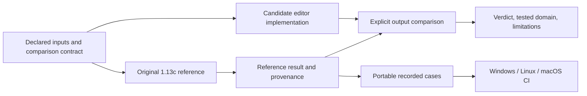

# Vanilla 1.13c compatibility and release testing design

Status: approved by the maintainer in this conversation on 2026-10-21. This
describes the testing program and its first release requirements; it does not
claim those tests exist.

## 1. Intent and decisions

The release should give users evidence that DS1Edit understands vanilla game
assets, preserves intended edits, produces maps the game interprets correctly,
and works from the distributed package.

The maintainer has selected:

1. Vanilla Diablo II 1.13c as the current compatibility target.
2. A hybrid system: recorded reference results in everyday CI, with live
   comparisons against the original game before releases.

The following engineering proposals were included in the approved design:

- Retain the Windows x86, Linux x86_64, and macOS arm64 editor targets advertised
  in README. The reference game runs in an appropriate Windows environment;
  portable recorded cases run on all three editor platforms.
- Start with a required core qualification profile, then expand expensive
  whole-asset comparisons. Section 10 defines the proposed first profile.
- Keep the editor-specific tests, contracts, and report in this repository;
  reuse d2-fleet for game process control and d2-decomp for reconstruction facts.

Other game patches and mod distributions are outside the initial reference
matrix. Historical DS1 format versions that ship in vanilla 1.13c are inside it.
User-created maps and the editor's mod-directory workflow remain test inputs;
they must not contaminate the vanilla reference corpus.

## 2. Starting evidence

The [release assessment](../../release-readiness.md) records the earlier local
measurements: Windows Release builds, all 29 CTest suites pass outside the
sandbox, extracted-package help and a GUI selftest pass, and five of six core
golden comparisons fail at tolerance 4. These are dated measurements, not
continuing claims about an arbitrary later checkout.

Existing tests cover many composition helpers, palette/cache operations, DT1
subtile pixels, project/preferences, selection, input edges, and CLI dispatch.
They do not directly test the DS1 reader/writer or real undo implementation.
The screenshot runner has reproduced false-success conditions: all cases can
skip with exit zero, and a failed renderer can be accepted if output exists.

The existing DS1, DT1, sprites, palette, and AnimData verification records are
valuable discovery inputs. Their statements must retain their original evidence
type and unresolved questions. In particular:

- The local extracted tile tree contains mixed vanilla and modified assets.
- Existing palette prose and current editor channel-order comments disagree;
  resolve that with identified bytes and game output before selecting goldens.
- Several identified DS1/DCC/AnimData routines have no recorded matched C entry.
- A recorded byte match establishes a reconstruction fact. It does not establish
  functional equivalence between that routine and the editor.
- Some vanilla files have tolerated short optional tails. A blanket rejection of
  every short file would break compatibility.

## 3. Approaches considered

| Approach | Strength | Cost or limitation | Decision |
| --- | --- | --- | --- |
| Recorded CI plus live release checks | Fast portable development checks with revalidation against original behavior | Requires provenance, freshness checks, and an isolated capture environment | Selected by maintainer |
| Live game for every equivalence run | Fresh original results for each comparison | Environment-dependent, slower, and unsuitable for ordinary hosted CI | Not selected |
| Recorded results without live revalidation | Simple replay infrastructure | Cannot establish that captures, adapters, or assumptions remain correct | Insufficient for the selected release requirement |

## 4. Test architecture and ownership

There are three execution lanes, each with explicit selection and a report.

| Lane | Runs | Inputs | Required environment |
| --- | --- | --- | --- |
| Portable | On every PR and supported platform | Authored synthetic fixtures, expected structured results, small redistributable reference cases | Existing C/Unity/CTest toolchain; Python helpers where needed |
| Corpus | Explicit local qualification invocation | Identified original MPQs, an immutable resolved asset manifest, candidate editor build | Local licensed installation and editor dependencies |
| Live reference | Before release and when reference contracts change | Declared vectors and game-side state recipes from the contracts | Isolated vanilla 1.13c game environment with an available invocation/observation adapter |

No recurring job is created by this design. Expensive sweeps can be scheduled
later if requested.

Game capture and editor evaluation must be independent. A model must not obtain
its expected output by calling the editor function it is testing. A recording
must not silently contain the candidate editor's output as its reference.

Proposed repository boundaries:

- `test/`: C tests and authored format fixtures following the existing Unity
  pattern. Production C is exercised directly where practical.
- `test/equivalence/`: editor comparison contracts, small recorded cases, and
  reference manifests. Keep game-derived bulk payloads outside tracked fixtures.
- `scripts/`: Python orchestration, schema checking, comparison, and reporting.
  Reuse existing Pillow support for image diagnostics.
- `tmp/`: generated local captures and qualification artifacts. Reports identify
  their content hashes so moving the output does not change its identity.
- `d2-decomp`: read-only discovery of module/RVA, source status, assembly, and
  prior question/verdict conventions. Do not alter reconstruction status.
- `d2-fleet`: reuse process control and the existing `reimpl/prove.py` facilities
  where their declared calling conventions and output contracts fit. Do not
  duplicate a general fleet client in the editor repository. An unmet adapter
  requirement is an explicit integration dependency, not an implicit permission
  to change sibling repositories.

REA supports static investigation and retained analysis evidence. Existing
Ghidra tools can supply an explicitly identified alternative evidence route.
Neither route substitutes static analysis for an executed comparison. The
current REA native backend needs configuration; that is a setup dependency for
that route, not a reason portable tests must depend on REA.

## 5. Reference identity and corpus

Create an immutable baseline manifest identifying:

- Original executable and relevant DLL SHA-256 values; edition/build identity
  from the available catalog, not a directory label alone.
- Each participating MPQ's SHA-256, archive priority, and the effective bytes
  resolved for every included virtual path.
- The enumeration sources and their limits. An MPQ listfile can omit assets;
  report catalogued coverage rather than claiming every possible archive member.
- For each asset: virtual path, source archive, byte length, content hash, and
  relevant format/version dimensions.
- Configuration, gamma, palette, zoom, frame/time, random seed, and overlay
  settings needed by visual or world-generation cases.

The vanilla lane disables user overlays, preferences, and implicit discovery.
Tests for overlays use separately declared synthetic or edited inputs. The
manifest is generated from the actual chosen baseline; historical corpus counts
in verification reports are cross-checks, not constants to copy blindly.

Portable tests must run without a Diablo II install, game DLLs, MPQs, REA, or
fleet access. Prefer authored fixtures and small structured expected values.
Archive payloads and decoded game artwork stay in the local corpus lane; do not
assume they may be copied into the public fixture set.

## 6. Equivalence contracts and evidence

Every comparison has a stable case/contract ID and declares:

1. The behavior being checked, original module + RVA or observation entry point,
   reference identity, and supporting REA/Ghidra/decomp evidence references.
2. Input domain, vector generator version and seed, and distinct input tuples.
3. Calling convention, required imports/globals, allocations, initialization,
   state dependencies, controllable inputs, and inputs/effects outside coverage.
4. Outputs: returned values, relevant memory writes, decoded structures or pixels,
   error outcomes, and any independently checked side effects.
5. Exact comparison and normalization rules. Exclude pointer addresses, padding,
   or editor-only metadata only when a named rule permits it. Endianness, signed
   values, pixel origins, and stride must be explicit.
6. At least one deliberately incorrect implementation/result that the comparator
   detects, with the particular claim that control challenges.

A captured result records contract version, original DLL/asset hashes, capture
adapter version, supporting evidence IDs when available, capture time, input and
result hashes, comparison policy, and limitations. Qualification additionally
records candidate source identity including a digest of any dirty changes,
build configuration/compiler, executable/package hashes, and platform.

For a live function call, verify live bytes against original module identity
before invoking it, accounting explicitly for relocations. Marshal pointers into
owned scratch memory and compare relevant writes. Use a disposable reference
process/member; required state and hazards must be understood before execution.
Custom calling conventions and hidden state are feasibility questions to prove,
not declarations inferred from a decompiler signature.

Recorded replay is a regression check against a captured contract. A live
comparison establishes agreement over its declared input set. Only genuinely
exhausted finite axes are labelled exhaustive. Existing fleet outcome names may
be retained, but reports must explain their bounded meaning and never promote
an observed or partial result into general equivalence.

### Example contracts

- **Tile keys:** exhaust all 64 main indices and 256 subindices, vary independent
  bits individually, and compare decoded keys. A seven-bit main-index mask must
  fail the control. Unknown flag semantics remain unknown while preservation
  tests can still check their raw values.
- **AnimData:** compare empty/nonempty buckets, colliding names, case handling,
  returned frame count and speed, and 160-byte record traversal. A wrong stride
  or case-sensitive hash must fail. Editor-specific fallback and millisecond
  rounding rules have their own assertions.
- **Map persistence:** load a declared map, perform an edit, save, and load the
  result using the game. Compare canonical dimensions, layers, objects, groups,
  and paths with the intended edit. Declare transformations for old-version
  upgrades, object-ID remapping, workspace metadata, and ignored fields before
  comparison; do not accidentally compare different processing stages.

## 7. System-wide behavior matrix

| Area | Required scenarios and outputs | Reference/acceptance method |
| --- | --- | --- |
| Installation and resources | Explicit install; missing/partial install; MPQ precedence; case and separator handling; overlay override/fallback; missing TXT columns; duplicate basenames | Controlled resources plus original 1.13c resolution cases; verify effective bytes and metadata |
| DS1 loading | Each shipped file-version family and threshold boundary; width/height plus-one; layer order/count; legacy orientation table; act; tags/groups; objects and paths | Compare parsed fields with identified original-loader output; authored fixtures and vanilla corpus |
| DS1 saving | Fresh save; repeated save/backup; temporary save; project redirection; old-format upgrade; multiple layers; flags and uninterpreted payload preservation where supported | Semantic save/reload plus original-loader validation; identify any intentional data transformations |
| Tile interpretation | Main/sub indices; orientation; hidden/unwalkable/shadow handling where established; DT1 association and missing keys | Exhaustive finite bitfields; named game cases; unresolved handoffs retained as evidence gaps |
| DT1 | Header/block offsets; isometric/RLE pixels; clipping; dimensions; empty/truncated subtiles; tile variants and animations | Indexed-buffer comparisons and structured metadata; bounds assertions for invalid inputs |
| DCC/DC6 | Directions/frames; signed origins; flip conventions; transparent runs; repeated/delta cells; cross-byte bitstreams; reused frame state | Original decoder outputs normalized to declared pixel origins and palette indices |
| Palette and AnimData | Actual palette selection; channel order; transparency; gamma; transform/table indexing; nearest-colour ties; hash collisions and timing | Identified game bytes/results; independently exercised authored vectors; isolate editor policy from game rules |
| COF and composition | Per-frame/direction priority; duplicate components; missing optional pieces; signed offsets; bounds; palette remaps and supported blend modes | Intermediate component/order/bounds assertions before final pixel comparison |
| Editing and undo | Tile/object/path create/move/delete/copy; selections and hidden layers; boundary edits; successive undo; map isolation | Real implementations on small maps; edit then undo restores declared state; save tests carry edits across persistence |
| Project/preferences | Create/load/save; path truncation; spaces; copy-on-save; original map preservation; switching maps/projects | Temporary filesystem integration and explicit state isolation |
| Exports | PNG/APNG decoded pixels; directions/frame order; delays; transparency; output naming/collisions; failure propagation; cancellation and progress cleanup | Independent file decoding, metadata/pixel comparisons, and controlled output failures |
| CLI and GUI | Argument errors/help; no-game setup; browser/open/edit/undo/save/reopen; modal key isolation; unsaved changes; resize/zoom; shutdown | Deterministic integration cases, display selftests, and a recorded manual checklist for remaining native interactions |
| Robustness/resources | Short/corrupt data; overflow lengths/counts; unterminated strings; invalid offsets; allocation/write/close failures; repeated map/export cycles | Graceful error requirements; sanitizers where supported; resource/leak checks; owned scratch outputs |
| Performance | First open; map switching/cache; representative decode/render/export; memory growth | Record workload/hardware/build; compare measured baseline and reviewed budgets; functional correctness remains separate |
| Distribution/docs | Extracted package startup; runtime closure; assets; paths with spaces; version consistency; macOS entry point; executable documented commands | Native platform jobs and clean-environment checks; exclude user caches/game data; verify README/BUILDING commands |

There is no original-game equivalent for the editor's undo, project UI, or
backup policy. Those require explicit editor invariants and workflow tests.

## 8. Failure behavior and trustworthy comparisons

- No selected cases, missing required fixtures, stale/mismatched identities,
  nonzero child exits, invalid/absent output, and timeouts cannot produce a
  passing qualification result.
- Distinguish mismatch, unavailable environment, unexecuted case, partial
  coverage, known compatible quirk, and expected invalid-input rejection.
- A selected required case that is unavailable blocks its lane. A portable-only
  invocation does not pretend it executed local or live lanes.
- Known quirks require exact case identities, expected behavior, evidence,
  rationale, and review. Counts or broad wildcards cannot hide new failures.
- For invalid inputs the editor must fail safely. Do not reproduce unsafe
  original-game reads or crashes as a compatibility requirement. Known vanilla
  short optional tails need narrowly defined compatibility fixtures.
- Compare structured fields and indexed pixels before RGB output and complete
  screenshots. This localizes whether a failure begins in parsing, asset
  selection, palette conversion, composition, or display.
- Pin time/frame, seed, and configuration before setting image tolerances.
  Require exact deterministic comparisons by default. Any tolerance or mask is
  part of a case's reviewed contract; it cannot be widened to hide a failure.
- Golden updates are an explicit reviewable operation with before/after outputs
  and supporting evidence. A failed comparison never updates its own expected
  result. Preserve actual output and diagnostics after failures.

## 9. Work packages and dependencies

Each package gets a focused implementation plan after design approval. This
program is too broad for one undifferentiated code change.

| Package | Deliverable | Depends on | Completion evidence |
| --- | --- | --- | --- |
| A. Result integrity | Strict screenshot/test-runner results, failure artifacts, explicit lane selection | Existing tests | Reproduced false-success cases fail; ordinary valid cases pass |
| B. Baseline and comparison pilot | 1.13c manifests, provenance/contract validation, one small original-vs-editor comparison, portable replay, wrong-model control | A | Identity mismatch refused; known-good vectors agree; negative control diverges; replay works without a game install |
| C. Map and edit integrity | DS1 fixtures/version matrix, actual undo/edit tests, safe save behavior, canonical game-side map validation | B for game comparisons; authored tests can start after A | Intended edits survive; undo restores state; backup/write failures are detected; vanilla map results accounted for |
| D. Visual and export correctness | Tile/sprite/palette/AnimData/COF cases, independent export decoding, deterministic map renders | B; parsed map truth from C | Field/indexed-pixel/RGB comparisons; explained existing golden mismatches; diagnostic artifacts |
| E. Robustness and performance | Corrupt-input generators, sanitizer/resource workloads, measured performance baselines | Relevant C/D interfaces | Reproducible seeds; safe failures; resource reports; reviewed budgets |
| F. Native distribution qualification | Package-content/startup jobs, end-to-end workflows, docs, combined qualification report | A; consumes C/D/E results | Native package evidence and complete required-profile report tied to the candidate artifacts |

The pilot should target a small, well-understood comparison such as tile-key
extraction or palette RLE transformation. Prove capture, comparison, and replay
before investing in the DS1 loader's custom entry/state wrapper. An uncallable
target remains an explicit missing capability until another observed route
provides the required outputs.

## 10. First release qualification profile

The maintainer approved this release scope with the design. Passing only the
current 29 suites is insufficient. The required profile is:

1. All existing and new portable tests pass on the three advertised platforms.
2. A freshly generated vanilla corpus manifest accounts for every enumerated
   DS1 and its required effective asset/table inputs. Every catalogued DS1 is
   exercised by the editor reader, with discrepancies classified and resolved or
   supported by narrowly reviewed vanilla-compatibility evidence.
3. The DS1 version/feature matrix covers each shipped family, and synthetic
   boundary fixtures exercise each relevant format threshold. Saved-map
   game-side comparisons cover each distinct writer feature: tile layers,
   orientations, objects, paths, groups/tags, format upgrade, and edited values.
   This is feature coverage, not a claim every possible edited map was tested.
4. Actual tile/object/path editing, undo, map isolation, backup, temporary save,
   project redirection, and write-failure requirements have direct tests.
5. A declared representative visual set spans all five acts and every supported
   decoder/composition feature from section 7. Every feature is mapped to case
   IDs. The six existing core maps are included after resolving their baseline
   asset identity and screenshot mismatches. All required indexed-pixel and
   final-output comparisons pass their explicit contracts.
6. Live revalidation executes every required reference contract against the
   pinned original game for the release candidate. The recorded case set and
   live results must agree; missing reference capabilities block qualification.
7. Controlled malformed-input and failed-save cases pass without silent success,
   uncontrolled writes, or data loss. A sanitizer run covers the exercised core
   parser/decoder paths on a supported host, with findings resolved.
8. Each platform's extracted package passes its content and startup checks in a
   declared clean environment. GUI workflow evidence covers edit/undo/save/
   reopen, modal input, and native platform startup integration.
9. The report records workload timing/memory baselines and any unexplained
   regressions for review; it does not invent a universal frame-rate requirement.
10. A single qualification report binds the required results to the candidate
    source/build/package identities. Any required mismatch, missing execution,
    unreviewed normalization, or unresolved data-loss defect blocks release.

Expanded sweeps of every DCC/DC6 frame, every COF combination, prolonged stress,
and additional generated cases are tracked separately. They do not silently
become claims made by the first profile. Newly discovered correctness defects
in supported behavior are still assessed as release defects, regardless of
which optional sweep discovered them.

Freshness is identity-based: live reference results bind the exact baseline,
contract/adapter versions, and candidate implementation for qualification.
Changed contracts/adapters/reference inputs invalidate affected captures;
changed candidate code or packages invalidate affected qualification results.
Portable recorded results remain a separate historical regression reference.

## 11. Reporting and completeness

Maintain a behavior ledger: each row names its feature/contract, owner package,
input dimensions, required lane/platforms, reference confidence, tested distinct
vectors/files/frames, results, limitations, and release-required status.

Report line/branch coverage of exercised production code, with stubs, vendored
Unity, generated adapters, and uninstrumentable parts disclosed. Suite counts,
repeated calls, or matching reconstructed bytes cannot stand in for behavior
coverage. A finite passing comparison is reported with its actual input scope.

Keep raw comparison artifacts and a compact human-readable report. Failures name
the earliest differing field/pixel, expected/actual values, input identity, and
reproduction command. Environment failures name the missing capability instead
of masquerading as product mismatches or passing skips.

## 12. Decisions left to implementation

Builders may settle exact C test adapter signatures, schema encoding details,
small-file decomposition, generated-case seed values, test labels, and native
invocation commands after inspecting the relevant subsystem. They must preserve
the identities, declared comparisons, portability, result semantics, and repo
ownership in this design.

Case selection for the representative visual set must be justified by feature
coverage and recorded in the ledger before it is accepted as release-complete.
The concrete 1.13c archive manifest and runtime adapters must be measured, not
filled in from directory names or old reports. Unknown game field semantics
remain unknown; preserve raw values where required without inventing meanings.

## 13. Explicit non-goals and constraints

- No other game-version or mod certification in the initial program.
- No byte-identical rewrite requirement for DS1Edit's C implementation.
- No assumption that a documentation claim or recovered C file is a live proof.
- No automatic golden blessing, broad failure allowlists, or passing empty runs.
- No copying licensed game executables or bulk assets into public CI fixtures.
- No unrelated broad refactor, general fleet replacement, or sibling-repo
  reconstruction changes hidden inside editor test work.
- No publication, tagging, or version change is authorized by approving this
  design; release execution remains a separate action.
- Preserve the existing staged/unstaged work. Isolate and review focused changes
  during implementation without discarding unrelated edits.

## 14. Source material

- [Release readiness assessment](../../release-readiness.md)
- [DS1 verification](../../guides/ds1-map-format.verification.md)
- [DT1 verification](../../guides/dt1-tile-format.verification.md)
- [DCC/DC6 verification](../../guides/sprite-formats-dcc-dc6.verification.md)
- [Palette verification](../../guides/palettes-and-colour.verification.md)
- [AnimData verification](../../guides/animdata-d2.verification.md)
- [COF verification](../../guides/cof-pipeline-1.13c.verification.md)
- Sibling `d2-decomp/equivalence/README.md`: domains, evidence outcomes, identity
  checks, deliberate wrong-model controls, and the existing question/prover seam.
- Sibling `d2-fleet/reimpl/prove.py`: current invocation/comparison capabilities
  and their input/output limitations; check applicability per reference target.

## 15. Review and approval

The maintainer approved this complete design, including the three-platform
scope and first-release qualification profile, with "Approved" in this
conversation on 2026-10-21. Implementation planning follows; this approval does
not assert that testing code or reference comparisons have been implemented.

An independent builder review completed with "nothing important left" to
clarify before planning. All seven local documentation links resolve. These
checks concern the design document, not implementation or product readiness.
